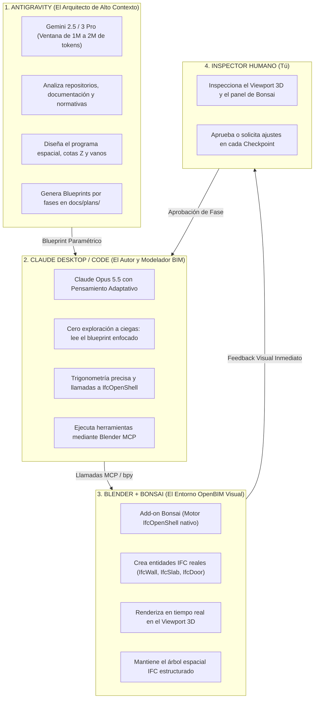
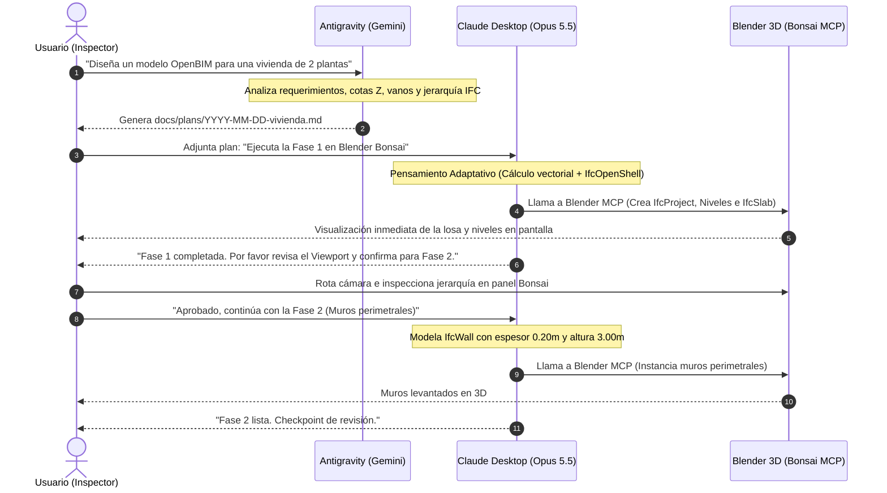
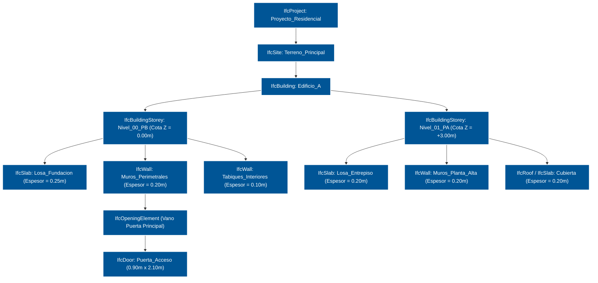
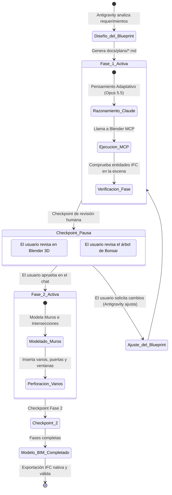

# Puente Colaborativo Antigravity <-> Claude <-> Blender Bonsai

> **Protocolo colaborativo multiagente y OpenBIM de última generación que une Google Antigravity (Arquitecto Estratégico de Alto Contexto), Anthropic Claude (Opus 5.5 / Sonnet como Ejecutor Quirúrgico y Modelador BIM) y Blender (Autoría OpenBIM nativa con Bonsai e IfcOpenShell).**

[](LICENSE)
[](https://www.buildingsmart.org/standards/bsi-standards/industry-foundation-classes/)
[](https://bonsaibim.org/)
[-7A52B3.svg)]()
[-4285F4.svg)]()

---

## 🌟 Resumen Ejecutivo

Cuando los modelos de IA intentan programar o modelar en 3D de forma autónoma sin una división estratégica de funciones, se enfrentan a dos problemas críticos:
1. **Saturación y Costo de Contexto:** Claude gasta entre el 50% y el 70% de su presupuesto explorando archivos a ciegas, buscando en directorios o procesando salidas de consola saturadas de texto.
2. **Sobrecarga Cognitiva en Modelado 3D y BIM:** Forzar a un único prompt a calcular planos arquitectónicos, cotas métricas, normativas de construcción, geometría espacial y la sintaxis de la API de Blender provoca alucinaciones de escala, topología rota o mallas poligonales genéricas sin datos BIM.

### La División Triangular del Trabajo



---

## 📊 Economía de Tokens: Por qué se Ahorra entre 70% y 85%

En Claude pagas por el acumulado de cada turno. Al utilizar a Antigravity como filtro arquitectónico y dividir la ejecución en fases con puntos de control (`/clear` o reinicio de contexto), se elimina el efecto bola de nieve:

| Métrica | Claude Autónomo (Solo) | Puente Triangular (Antigravity + Claude + Bonsai) | Impacto Real |
| :--- | :--- | :--- | :--- |
| **Contexto de Entrada (Lectura)** | 800.000 – 1.400.000 tokens *(re-enviando todo el proyecto en cada turno)* | 100.000 – 180.000 tokens *(únicamente el plan y los archivos de la fase)* | **~85% de ahorro** |
| **Ruido de Terminal y Logs** | 100.000 – 200.000 tokens *(trazas de error y consola completas)* | 15.000 – 25.000 tokens *(comprimido y filtrado por MCP/RTK)* | **~80% de ahorro** |
| **Tokens de Salida (Respuestas)** | 15.000 – 25.000 tokens *(explicaciones largas y cortesías innecesarias)* | 3.000 – 5.000 tokens *(ejecución directa de herramientas)* | **~75% de ahorro** |
| **Turnos de Ensayo y Error** | 12 a 20 turnos | 3 a 5 turnos atómicos | **~70% menos turnos** |
| **Costo por Modelo / Tarea** | **$4.00 – $8.00 USD** | **$0.40 – $0.90 USD** | **80% a 85% más económico** |

---

## 🔄 Flujo de Trabajo en Secuencia: De la Idea al Modelo OpenBIM



---

## 🏗️ Jerarquía Espacial de Contención OpenBIM (IFC4)

A diferencia del modelado poligonal tradicional, los elementos generados por este sistema respetan el estándar nativo de **BuildingSMART (IFC4)**:



---

## 🚦 Máquina de Estados de Fases y Checkpoints de Revisión



---

## 📦 Skills Incluidas en este Repositorio

| Skill | Entorno | Rol | Descripción |
| :--- | :--- | :--- | :--- |
| **`claude-planner`** | Antigravity (Gemini) | Arquitecto Planificador | Genera blueprints paramétricos en `docs/plans/YYYY-MM-DD-<tarea>.md` estructurados por fases y con comandos de verificación. |
| **`antigravity-executor`** | Claude Code (CLI) | Ejecutor Quirúrgico | Ejecuta tareas una a una, marca `- [x]` en disco, se detiene en los checkpoints y sugiere `/clear` para resetear tokens. |
| **`bonsai-bim-orchestrator`** | Antigravity y Claude | Especialista OpenBIM | Contiene las directivas de IFC4, jerarquías de niveles, reglas de Bonsai y el módulo de referencia Python `bonsai-api-cheatsheet.py`. |

---

## 🚀 Instalación Rápida (1 Clic en cualquier computador)

Clona el repositorio en cualquier máquina y ejecuta el instalador universal:

```bash
git clone https://github.com/zebas-hidalgo/antigravity-claude-bridge.git
cd antigravity-claude-bridge
chmod +x install.sh
./install.sh
```

### Lo que realiza el instalador de forma automática:
1. Instala `claude-planner` en `~/.gemini/config/skills/claude-planner/`.
2. Instala `antigravity-executor` en `~/.claude/skills/antigravity-executor/`.
3. Instala `bonsai-bim-orchestrator` y su cheatsheet en ambos entornos.
4. Vincula la regla automática en tu `~/.claude/CLAUDE.md`.

---

## ⚙️ Configuración para la App de Claude Desktop (Interfaz Gráfica)

Si utilizas la **App de Claude Desktop** en tu computador:

### 1. Conectar Blender MCP en Claude Desktop
Edita el archivo de configuración de Claude Desktop ubicado en:  
`~/Library/Application Support/Claude/claude_desktop_config.json`

Añade la sección `"mcpServers"` para Blender:

```json
{
  "mcpServers": {
    "blender": {
      "command": "/Users/<TU_USUARIO>/.local/bin/uvx",
      "args": ["blender-mcp"]
    }
  }
}
```

### 2. Crear un Proyecto en Claude Desktop
1. En la App de Claude Desktop, ve a la sección **Projects** (Proyectos) y crea uno llamado:  
   `Bonsai OpenBIM Studio`.
2. En **Project Instructions** (Instrucciones personalizadas del proyecto), copia y pega el contenido de [`templates/claude-project-instructions.md`](templates/claude-project-instructions.md).
3. Configura el modelo:
   * **Modelo:** **Claude Opus 5.5**
   * **Esfuerzo de pensamiento:** **Adaptive Thinking (Alto / Profundo)**

### 3. Conectar Blender en Vivo
1. Abre Blender con el add-on de **Bonsai** y **Blender MCP** activados.
2. En la barra lateral del Viewport 3D (`tecla N`), abre la pestaña de Blender MCP y haz clic en **"Start MCP Server"**.
3. Abre Claude Desktop: verás el icono del martillo (🔨) indicando que las herramientas de Blender están listas para usarse.

---

## 🎨 Ciclo de Trabajo Paso a Paso

### 1. Antigravity genera el blueprint
Le pides a Antigravity:
> *"Diseña un plan OpenBIM para un pabellón modular con Bonsai en `docs/plans/2026-10-15-pabellon.md`"*

Antigravity activa `claude-planner` y `bonsai-bim-orchestrator`, generando las fases paramétricas con cotas $Z$, espesores y jerarquía IFC.

### 2. Ejecución en Claude Desktop
1. Abres un chat en tu proyecto `Bonsai OpenBIM Studio` en Claude Desktop.
2. Arrastras el archivo `docs/plans/2026-10-15-pabellon.md` al chat.
3. Escribes:  
   > *"Por favor ejecuta la Fase 1 del plan en Blender Bonsai."*

### 3. Claude Opus 5.5 modela en directo
* Claude activa su pensamiento profundo, planifica la llamada a `ifcopenshell.api` y ejecuta el comando a través de Blender MCP.
* Verás crearse en tiempo real los niveles y la losa en tu ventana de Blender abierta.
* Claude se detiene en el checkpoint y te solicita revisión.

### 4. Revisión visual humana
* Inspeccionas el modelo en el Viewport 3D de Blender.
* Si todo es correcto, respondes en el chat:  
  > *"Aprobado, continúa con la Fase 2 (Muros)."*

---

## 🛡️ Protocolo de Diagnóstico y Recuperación de Errores

Si alguna operación de Blender o validación de IfcOpenShell falla tras 1 intento rápido de autocorrección, Claude se detiene inmediatamente y emite este bloque de diagnóstico:

```markdown
### [REPORTE DIAGNÓSTICO PARA ANTIGRAVITY]
- **Fase / Tarea Fallida:** Fase 2 / Tarea 2.1
- **Clase IFC / Entidad:** IfcWall / Wall_Exterior_01
- **Traza del Error:** RuntimeError: Active IFC project not loaded in Bonsai
- **Causa Sospechada:** Se abrió una escena limpia sin inicializar IfcProject
```

Copias este bloque en Antigravity y este ajusta el blueprint de inmediato sin que gastes tokens de Claude en bucles de ensayo y error.

---

## 📄 Licencia
Distribuido bajo la licencia MIT. Consulta el archivo [LICENSE](LICENSE) para más detalles.  
Copyright (c) 2026 Sebastián Hidalgo
