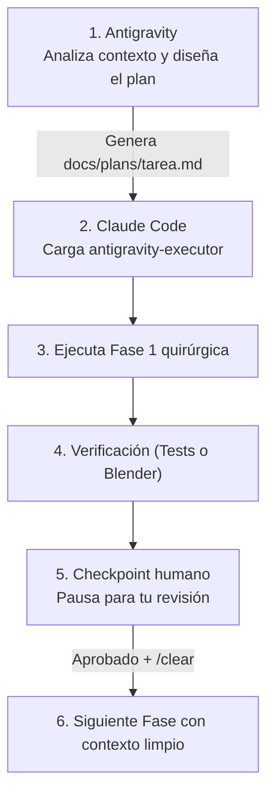

# Antigravity <-> Claude Code Bridge

> **A dual-skill collaborative protocol connecting Google Antigravity (as the High-Context Architect) with Anthropic Claude Code (as the Surgical Executor & 3D Modeler).**

[](LICENSE)
[]()

---

## 💡 Why This Architecture?

Running Claude Code autonomously across large codebases or complex MCPs (such as Blender) quickly encounters two major bottlenecks:
1. **Context Window Bloat & Cost:** Claude burns 50%+ of its tokens simply exploring files, reading directories, or processing noisy console outputs.
2. **Multi-task Overload:** Attempting to architect, write tests, coordinate files, and model geometry simultaneously degrades reasoning and triggers trial-and-error loops.

### The Architect vs. Surgeon Division

| Role | Agent | Model Strength | Primary Responsibility |
| :--- | :--- | :--- | :--- |
| **Architect / Planner** | **Antigravity** | Gemini (1M–2M Context Window) | Ingests entire repositories, documentation, and specs. Designs phased blueprints with zero token cost anxiety. |
| **Surgical Executor** | **Claude Code** | Claude 3.7 Sonnet / Opus | Executes one atomic phase at a time with extreme code precision, runs tests, and drives MCPs (like Blender 3D modeling). |

**Real-world Impact:** Slashes Claude token consumption and costs by **70% to 85%** per task.

---

## 🚀 Quick Install (Any Machine)

Clone the repository and run the installer:

```bash
git clone https://github.com/<your-username>/antigravity-claude-bridge.git
cd antigravity-claude-bridge
chmod +x install.sh
./install.sh
```

### What the installer does:
1. Installs `claude-planner` into `~/.gemini/config/skills/claude-planner/SKILL.md` (for Antigravity).
2. Installs `antigravity-executor` into `~/.claude/skills/antigravity-executor/SKILL.md` (for Claude Code).
3. Adds the automatic trigger rule into your global `~/.claude/CLAUDE.md`.

---

## 📁 Repository Structure

```text
antigravity-claude-bridge/
├── install.sh                  # One-click global installer
├── uninstall.sh                # Clean uninstaller
├── skills/
│   ├── claude-planner/         # Antigravity skill (Generates blueprints)
│   │   └── SKILL.md
│   └── antigravity-executor/   # Claude Code skill (Executes blueprints)
│       └── SKILL.md
├── templates/
│   ├── plan-template-code.md   # Standard plan for software features / refactors
│   ├── plan-template-blender.md# 3D blueprint for Blender MCP
│   └── CLAUDE.md               # Base rules for Claude Code
├── LICENSE                     # MIT License
└── README.md
```

---

## 🛠️ Daily Workflow



### 1. In Antigravity (Generate the Blueprint)
Prompt Antigravity to design your plan:
> *"Planifica la refactorización de nuestro sistema de autenticación para Claude Code en `docs/plans/2026-10-15-auth-refactor.md`"*
*(Or for 3D modeling)*:
> *"Diseña el blueprint para modelar un dron de 4 hélices en Blender en `docs/plans/2026-10-15-dron-blender.md`"*

Antigravity activates `claude-planner` and creates a phased plan with review checkpoints, exact targets, and zero ambiguity.

### 2. In Claude Code (Execute Step-by-Step)
In your terminal, navigate to your project and launch:

```bash
claude "Ejecuta el plan docs/plans/2026-10-15-auth-refactor.md"
```

* Claude automatically triggers `antigravity-executor`.
* It marks completed tasks `- [x]` directly on disk.
* It stops at `[CHECKPOINT: User Review]`.
* Run `/clear` in Claude, review changes, and proceed to the next phase.

---

## 🧊 Domain Specialization: Blender 3D (via Blender MCP)

When modeling 3D assets in Blender:
* **Antigravity does NOT micromanage every vertex:** It defines the **Spatial Blueprint** (metric bounding boxes, coordinate pivots, modifier stacks, collections, and topology rules).
* **Claude does the actual 3D modeling:** Claude uses its spatial intelligence to generate and test the Python `bpy` code interactively through Blender MCP.
* **Viewport Review:** Claude pauses after each visual phase (Blockout → Detailing → Shaders) so you can rotate and inspect the 3D model in Blender before proceeding.

---

## ⚡ Recommended Token-Saving Companion Tools

To maximize savings, install these companion tools alongside this bridge:

1. **Caveman Skill (Cuts output tokens by 65–75%):**
   ```bash
   claude plugin marketplace add JuliusBrussee/caveman
   claude plugin install caveman@caveman
   ```
2. **RTK Proxy (Filters noisy terminal & test logs):**
   ```bash
   cargo install rtk-cli && rtk init -g
   ```
3. **claude-mem (Persistent cross-session memory via SQLite):**
   ```bash
   claude mcp add claude-mem -- npx -y claude-mem
   ```

---

## 🛡️ Error Recovery Protocol

If Claude hits a test failure or an MCP error:
1. It attempts **one (1)** quick correction.
2. If it fails again, it halts and generates an **Antigravity Diagnostic Report**:
   ```markdown
   ### [ANTIGRAVITY DIAGNOSTIC REPORT]
   - Phase / Task Failed: Phase 1 / Task 1.2
   - Command / Action: bpy.ops.transform.resize(...)
   - Error Output: RuntimeError: Context incorrect
   - Suspected Cause: Active object was not selected before resize
   ```
3. Copy-paste this block into Antigravity. Antigravity fixes the blueprint without burning Claude tokens in long debug loops.

---

## 📄 License
MIT © 2026
