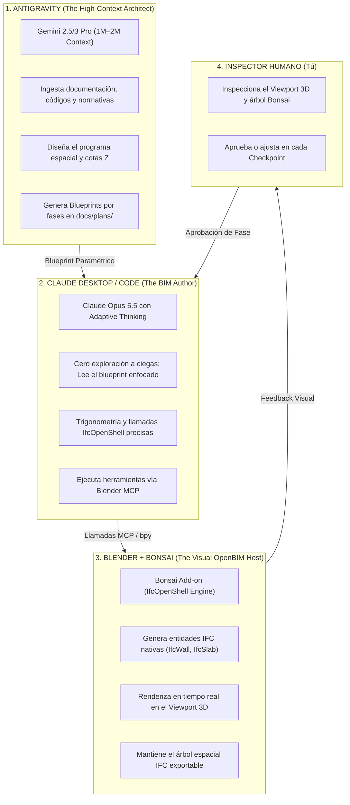
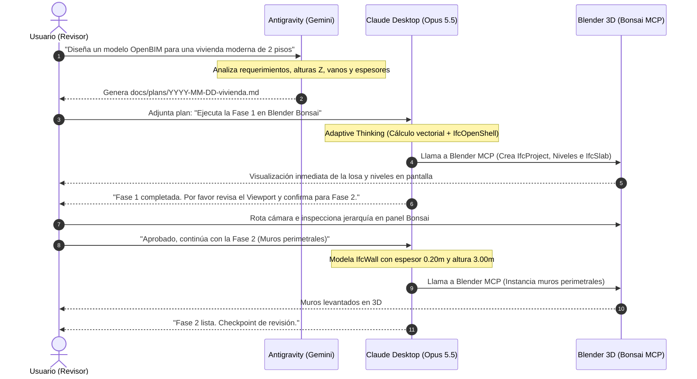
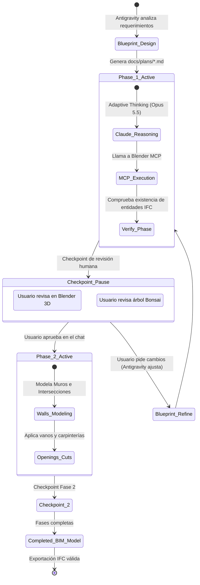

# Antigravity <-> Claude <-> Blender Bonsai Bridge

> **A Next-Generation OpenBIM & Multi-Agent Collaborative Protocol uniting Google Antigravity (High-Context Strategic Architect), Anthropic Claude (Opus 5.5 / Sonnet Surgical Executor), and Blender (Native OpenBIM authoring powered by Bonsai & IfcOpenShell).**

[](LICENSE)
[](https://www.buildingsmart.org/standards/bsi-standards/industry-foundation-classes/)
[](https://bonsaibim.org/)
[-7A52B3.svg)]()
[-4285F4.svg)]()

---

## 🌟 Executive Overview

Autonomous AI coding and 3D modeling typically face severe failure modes when executed in isolation:
1. **Context Window Exhaustion:** Claude burns 50% to 70% of its budget searching repositories, inspecting directories, or processing noisy console outputs.
2. **Cognitive Overload in 3D/BIM:** Forcing a single prompt to calculate spatial coordinates, architectural programs, parametric building codes, and API syntax leads to hallucinated scales, broken topologies, or unclassified generic polygons.

### The Triangular Division of Labor



---

## 📊 Token Economics: Why This Saves 70%–85%

| Metric | Autonomous Claude (Solo) | Triangular Bridge (Antigravity + Claude + Bonsai) | Net Impact |
| :--- | :--- | :--- | :--- |
| **Input Context Overhead** | 800.000 – 1.400.000 tokens *(re-enviando todo el repo en cada turno)* | 100.000 – 180.000 tokens *(sólo el plan específico de la fase)* | **~85% de ahorro** |
| **Terminal / Console Noise** | 100.000 – 200.000 tokens *(trazas de error y logs sin filtrar)* | 15.000 – 25.000 tokens *(comprimido con RTK / filtrado MCP)* | **~80% de ahorro** |
| **Conversational Output** | 15.000 – 25.000 tokens *(explicaciones y cortesías)* | 3.000 – 5.000 tokens *(ejecución directa y concisa)* | **~75% de ahorro** |
| **Turnos de Ensayo y Error** | 12 a 20 turnos | 3 a 5 turnos estructurados | **~70% menos turnos** |
| **Costo por Modelo / Tarea** | **$4.00 – $8.00 USD** | **$0.40 – $0.90 USD** | **80% a 85% más barato** |

---

## 🔄 Sequence Workflow: From Idea to OpenBIM Model



---

## 🏗️ OpenBIM Spatial Containment Hierarchy

A diferencia del modelado poligonal ciego, todos los elementos modelados por esta arquitectura respetan el estándar nativo de **BuildingSMART (IFC4)**:


---

## 🚦 Phase State Machine & Review Checkpoints



---

## 📦 Skills Incluidas en este Paquete

| Skill | Entorno | Rol | Descripción |
| :--- | :--- | :--- | :--- |
| **`claude-planner`** | Antigravity (Gemini) | Arquitecto | Diseña blueprints paramétricos en `docs/plans/YYYY-MM-DD-<tarea>.md` optimizados para Claude Code y Desktop. |
| **`antigravity-executor`** | Claude Code (CLI) | Ejecutor Quirúrgico | Ejecuta tareas paso a paso, persiste el estado con `- [x]` en disco, pausa en checkpoints y recomienda `/clear`. |
| **`bonsai-bim-orchestrator`** | Antigravity & Claude | Especialista OpenBIM | Contiene las reglas IFC4, jerarquías de niveles, buenas prácticas de Bonsai y el módulo de referencia `bonsai-api-cheatsheet.py`. |

---

## 🚀 Instalación Rápida (1-Click en cualquier computador)

Clona el repositorio y ejecuta el instalador universal:

```bash
git clone https://github.com/zebas-hidalgo/antigravity-claude-bridge.git
cd antigravity-claude-bridge
chmod +x install.sh
./install.sh
```

### Lo que hace el instalador:
1. Instala `claude-planner` en `~/.gemini/config/skills/claude-planner/`.
2. Instala `antigravity-executor` en `~/.claude/skills/antigravity-executor/`.
3. Instala `bonsai-bim-orchestrator` y su cheatsheet en ambos entornos.
4. Vincula la regla automática en tu `~/.claude/CLAUDE.md`.

---

## ⚙️ Configuración para la App de Claude Desktop (GUI)

Si utilizas la **App de Claude Desktop** (sin terminal):

### 1. Conectar Blender MCP en Claude Desktop
Edita `~/Library/Application Support/Claude/claude_desktop_config.json`:

```json
{
  "mcpServers": {
    "blender": {
      "command": "/Users/<TU_USUARIO>/.local/bin/uvx",
      "args": ["blender-mcp"]
    }
  }
}
```

### 2. Crear un Proyecto en Claude Desktop
1. Crea un proyecto llamado: `Bonsai OpenBIM Studio`.
2. En **Project Instructions**, pega el contenido de [`templates/claude-project-instructions.md`](templates/claude-project-instructions.md).
3. Selecciona:
   * **Modelo:** **Claude Opus 5.5**
   * **Pensamiento:** **Adaptive Thinking (Alto / Profundo)**

### 3. Conectar Blender
1. Abre Blender con el add-on de **Bonsai** y **Blender MCP**.
2. En la barra lateral (`N`), abre Blender MCP y haz clic en **"Start MCP Server"**.

---

## 🛡️ Protocolo de Diagnóstico y Recuperación de Errores

Si alguna operación de Blender o test falla tras 1 intento rápido de autocorrección, Claude se detiene inmediatamente y genera este bloque:

```markdown
### [ANTIGRAVITY DIAGNOSTIC REPORT]
- **Phase / Task Failed:** Fase 2 / Tarea 2.1
- **IFC Class / Objeto:** IfcWall / Wall_Exterior_01
- **Error Trace:** RuntimeError: Active IFC project not loaded in Bonsai
- **Suspected Cause:** El usuario abrió una escena nueva sin inicializar IfcProject
```

Pega este bloque en Antigravity y este ajustará el blueprint de inmediato sin quemar tokens de Claude en bucles de ensayo y error.

---

## 📄 Licencia
MIT © 2026 Sebastián Hidalgo
