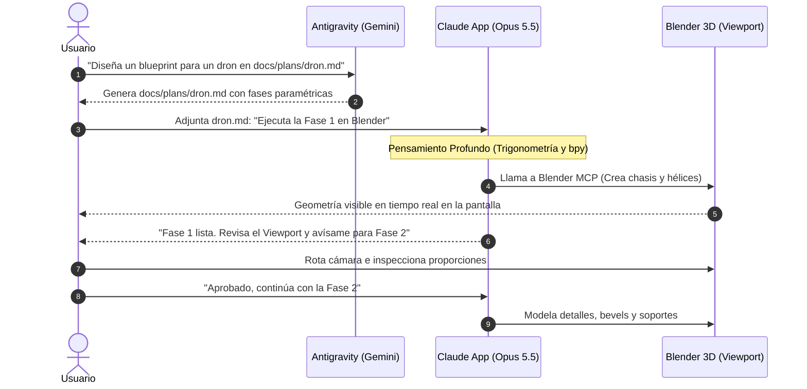

# Guía de Modelado 3D: Antigravity + Claude Desktop (App) + Blender MCP

Esta guía detalla el flujo de trabajo 100% verificado para usar la **App de Claude Desktop** (sin terminal) junto a **Blender MCP** y **Antigravity**.

---

## 🏗️ Los 3 Pilares del Flujo

1. **El Cerebro Arquitecto (Antigravity):** Diseña el blueprint paramétrico con proporciones, bounding boxes y colecciones.
2. **El Escultor 3D (Claude Opus 5.5 en Claude Desktop):** Utiliza su razonamiento espacial adaptativo y llamadas MCP para modelar la geometría en directo en tu Blender abierto.
3. **El Inspector Humano (Tú):** Rotas la escena en el viewport de Blender en cada checkpoint antes de dar la orden de continuar.

---

## ⚙️ Configuración Inicial (Solo se hace una vez)

### Paso 1: Configurar Blender MCP en Claude Desktop
Abre tu archivo de configuración de Claude Desktop:
`~/Library/Application Support/Claude/claude_desktop_config.json`

Asegúrate de agregar la sección `"mcpServers"` para Blender MCP:

```json
{
  "mcpServers": {
    "blender": {
      "command": "uvx",
      "args": ["blender-mcp"]
    }
  }
}
```
*(Nota: Si usas una versión con Node/npx, el comando suele ser `"command": "npx", "args": ["-y", "blender-mcp"]`)*.

### Paso 2: Activar el Add-on en Blender
1. Abre Blender.
2. Ve a **Edit > Preferences > Add-ons**.
3. Instala/Activa el add-on de **Blender MCP**.
4. Haz clic en **Start Server** (habitualmente abre el socket en `localhost:9876`).

### Paso 3: Crear el Proyecto en la App de Claude Desktop
1. En la App de Claude Desktop, ve a la sección **Projects** (Proyectos) y crea uno llamado:
   `3D Modeling & Blender Studio`
2. En **Project Instructions** (Instrucciones personalizadas del proyecto), copia y pega el contenido de:
   [`templates/claude-project-instructions.md`](../templates/claude-project-instructions.md).
3. Selecciona el modelo:
   * **Modelo:** **Claude Opus 5.5**
   * **Esfuerzo de pensamiento:** **Adaptive Thinking (Alto / Profundo)**

---

## 🎨 El Ciclo de Modelado en el Día a Día



### 1. Antigravity genera el blueprint
Le pides a Antigravity:
> *"Genera el blueprint 3D para una cafetera espresso retro en `docs/plans/2026-10-15-cafetera.md`"*

Antigravity activa `claude-planner` y crea el archivo con especificaciones métricas, jerarquía de colecciones y checkpoints.

### 2. Pasas el archivo al Proyecto de Claude Desktop
1. En tu proyecto de Claude Desktop, abre un nuevo chat.
2. Arrastra y suelta el archivo `docs/plans/2026-10-15-cafetera.md` en la conversación.
3. Escribe:
   > *"Por favor ejecuta la Fase 1 del blueprint adjunto en Blender usando las herramientas MCP."*

### 3. Claude Opus 5.5 modela en directo
* Verás a Claude entrar en su modo de **pensamiento adaptativo**, calculando la geometría.
* Segundos después, verás cómo en tu ventana de Blender los objetos se crean y se alinean automáticamente.
* Claude se detiene en el Checkpoint y te pide tu revisión visual.

### 4. Revisión y siguiente fase
* Miras en Blender el chasis y la escala.
* Si te gusta, simplemente respondes en el chat:
  > *"Excelente, procede con la Fase 2 (Detalles y Modificadores)."*
