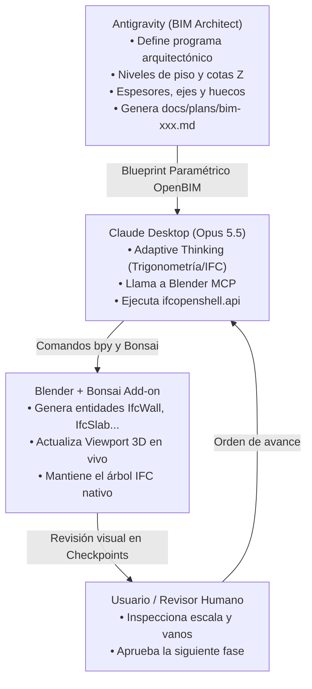

# Bonsai BIM Orchestrator

## Overview
Coordinates OpenBIM architectural modeling between **Antigravity** (BIM Planner & Spatial Architect), **Claude Desktop / Opus 5.5** (BIM Author & Code Executor), and **Blender** (running the native **Bonsai / IfcOpenShell** add-on via Blender MCP).

Ensures all generated architectural elements conform strictly to the **IFC4/IFC2X3 OpenBIM standard** rather than unclassified, generic polygonal meshes.

---

## When to Use
- Planning or modeling buildings, houses, structures, and interior architectural layouts in Blender.
- When native OpenBIM IFC data (walls, slabs, doors, windows, levels, property sets) is required.
- Executing architectural blueprints in Claude Desktop connected to Blender via Blender MCP.

Do NOT use for:
- Non-architectural organic 3D modeling (characters, sculpts, VFX props) — use standard `claude-planner` instead.
- Pure code tasks unrelated to 3D/BIM.

---

## The Triangular Architecture



---

## Core OpenBIM Standards

### 1. Spatial Structure (Hierarchy)
Every project MUST respect the standard IFC containment tree:
`IfcProject` ➔ `IfcSite` ➔ `IfcBuilding` ➔ `IfcBuildingStorey` (con elevaciones Z explícitas).
* Elements MUST belong to an `IfcBuildingStorey` container (`Nivel 00 PB`, `Nivel 01 PA`, etc.). Never leave elements floating without spatial assignment.

### 2. Semantic Element Classification
Do NOT create plain Blender meshes. All objects must be instantiated or classified as proper IFC classes:
- **Muros:** `IfcWall` o `IfcWallType`
- **Losas / Pisos / Techos planos:** `IfcSlab` (PredefinedType: `FLOOR`, `BASESLAB`, `ROOF`)
- **Pilares / Columnas:** `IfcColumn`
- **Vigas:** `IfcBeam`
- **Vanos y Puertas:** `IfcOpeningElement` (booleano sustractivo) + `IfcDoor`
- **Vanos y Ventanas:** `IfcOpeningElement` + `IfcWindow`
- **Escaleras:** `IfcStair`

---

## Plan Structure (For Antigravity)

When generating an OpenBIM plan, Antigravity must follow the template in `templates/plan-template-bonsai.md` and divide the work into these 4 standard phases:

1. **Fase 1: Configuración de Proyecto y Niveles (`IfcProject`, `IfcSite`, `IfcBuildingStorey`, `IfcSlab` base).**
2. **Fase 2: Envolvente y Muros (`IfcWall` perimetrales e interiores con espesores y alturas).**
3. **Fase 3: Carpinterías y Vanos (`IfcDoor`, `IfcWindow` con cotas de antepecho y dimensiones).**
4. **Fase 4: Estructura Superior y Cubierta (`IfcSlab` de entrepiso, `IfcBeam`, `IfcRoof`).**

Each phase MUST conclude with:
```markdown
> **[CHECKPOINT: User Review]**  
> Stop here. Inform user that Phase X is complete. Prompt user to inspect the Bonsai spatial tree and 3D Viewport in Blender. Wait for confirmation before proceeding.
```

---

## Execution Directives (For Claude Desktop / Opus 5.5)

1. **One Phase at a Time:** Never execute multiple phases in a single turn. Wait for explicit user confirmation at checkpoints.
2. **Accessing the Bonsai Model:**
   ```python
   import bonsai.bim.tool as tool
   model = tool.Ifc.get()
   ```
3. **Using IfcOpenShell API:** Always favor `ifcopenshell.api.run(...)` over raw Blender operators for entity creation and spatial assignment (see `bonsai-api-cheatsheet.py`).
4. **Refreshing Viewport:** After creating entities, trigger a view refresh so the geometry displays immediately on the user's screen.
5. **Fast-Stop on Errors:** If an IfcOpenShell operation raises an error, attempt 1 quick fix. If it persists, stop and deliver the `[ANTIGRAVITY DIAGNOSTIC REPORT]`.
